<div align="center">



<br>

<a href="https://vichaar-adarsh.vercel.app/"></a>
<a href="https://www.linkedin.com/in/adarsh-s-vajrawad-4ba66b386"></a>

<br><br>

<a href="#portfolio"></a>
<a href="#snapshot"></a>
<a href="#research"></a>
<a href="#repos"></a>
<a href="#projects"></a>
<a href="#connect"></a>

<br><br>


<br>


</div>


<a id="portfolio"></a>

## 🌐 Portfolio

<div align="center">

<a href="https://vichaar-adarsh.vercel.app/"></a>

<br>

<a href="https://vichaar-adarsh.vercel.app/"></a>
<a href="https://vichaar-adarsh.vercel.app/repos.html"></a>
<a href="https://vichaar-adarsh.vercel.app/contact.html"></a>

</div>

<details>
<summary><b>🧪 What's inside the portfolio</b> &nbsp;(click to expand)</summary>

<br>

| Page | What you get |
|:---|:---|
| [**About me**](https://vichaar-adarsh.vercel.app/) | Bio, education, a draggable **3D silicon chip** (three.js) and an interactive **full-adder lab** |
| [**GitHub repos**](https://vichaar-adarsh.vercel.app/repos.html) | Pulled live from the GitHub API, with filters |
| [**Contact**](https://vichaar-adarsh.vercel.app/contact.html) | Opens your mail app with the message pre-filled |

Built with plain HTML, CSS and JavaScript plus three.js, with no build step. It respects reduced-motion settings and falls back gracefully without WebGL.

</details>


<a id="snapshot"></a>

## 🧠 Snapshot

> **I'm an Electronics & Communication Engineering student who wants to understand hardware end to end: from the transistor to the system to the research paper.**

<table>
<tr>
<td width="50%" valign="top">

**🎓 Education**<br>
BE Electronics & Communication Engineering (2nd year)<br>
Cambridge Institute of Technology, Bengaluru

**🎯 Primary focus**<br>
VLSI · RTL design · Computer arithmetic · Approximate computing

</td>
<td width="50%" valign="top">

**🛠️ I work with**<br>
Verilog · Python · C / C++ · Java · Git<br>
Arduino · ESP32 · LoRa · Sensors · Wireless communication

**🤝 Open to**<br>
Research collaboration · VLSI / hardware projects · Internships

</td>
</tr>
</table>

```text
CIRCUIT → LOGIC → ARCHITECTURE → RTL → HARDWARE → SYSTEM → RESEARCH
```

<div align="center">


</div>


<a id="research"></a>

## 🔬 Research: Approximate Computing

**The question I'm chasing:** *how much accuracy can a circuit give up in exchange for lower power, smaller area and faster delay?*

Approximate arithmetic is useful where small errors are tolerable, such as image and signal processing and machine-learning inference. A multiplier's partial-product reduction tree is built from compressors, so I start with the **4:2 compressor** and work up to the multiplier.

<details>
<summary><b>🔢 The exact 4:2 compressor (my baseline)</b></summary>

<br>

```text
inputs : X1 X2 X3 X4 CIN        outputs : SUM, CARRY, COUT

X1 + X2 + X3 + X4 + CIN  =  SUM + 2 × (CARRY + COUT)

SUM   = X1 ⊕ X2 ⊕ X3 ⊕ X4 ⊕ CIN
COUT  = (X1 ⊕ X2) ? X3 : X1
CARRY = (X1 ⊕ X2 ⊕ X3 ⊕ X4) ? CIN : X4
```

An approximate design simplifies these equations. Some of the 32 input combinations then give a wrong output, and the job is to measure how wrong, how often, and what is saved.

</details>

<details>
<summary><b>📐 How I evaluate a design</b></summary>

<br>

| Metric | What it tells me |
|:---|:---|
| Error Rate | How often the output is wrong |
| Error Distance | Gap between exact and approximate output |
| Mean / Worst-case Error | Average and maximum damage |
| Power · Area · Delay | What the approximation actually buys |

```text
truth table → error distance → error pattern → multiplier effect → application effect → research gap
```

</details>

<details>
<summary><b>📚 My paper-reading workflow</b></summary>

<br>

```text
find → read → note → reproduce → compare → find limits → research gap → design → Verilog → simulate → analyse → improve
```

For each paper I extract: **problem · existing design · proposed design · truth table · error analysis · area / power / delay · limitations · research gap.**

My reviewed papers live in [Review-Papers](https://github.com/dracsInfi19/Review-Papers).

</details>

<details>
<summary><b>💻 RTL / Verilog roadmap</b></summary>

<br>

```text
Boolean algebra → gates → combinational → sequential → Verilog modules
   → testbenches → simulation → RTL → synthesis → area / power / delay → VLSI
```

</details>


<a id="repos"></a>

## 📦 Repositories

| Repo | What's in it |
|:---|:---|
| [**Gods-Hand**](https://github.com/dracsInfi19/Gods-Hand) | LoRa mesh SOS system for flood scenarios: gateway engine, simulator, 23 unit tests, web dashboard |
| [**Review-Papers**](https://github.com/dracsInfi19/Review-Papers) | Reviewed research papers with notes |
| [**RESEARCH-PAPERS**](https://github.com/dracsInfi19/RESEARCH-PAPERS) | Deep learning and research of quantum domains |
| [**Classical-Projects**](https://github.com/dracsInfi19/Classical-Projects) | Classical engineering projects |
| [**Python_practice**](https://github.com/dracsInfi19/Python_practice) | Python practice problems in one place |
| [**SipkeCenter-X-Adarsh**](https://github.com/dracsInfi19/SipkeCenter-X-Adarsh) | An educational website (HTML) |

<a id="projects"></a>

## 🚀 Project Lab

<table>
<tr>
<td width="33%" valign="top" align="center">

### [📡 Gods Hand](https://github.com/dracsInfi19/Gods-Hand)
**LoRa mesh SOS system**

`Python` `LoRa` `ESP32` `Dijkstra` `DBSCAN` `Kalman`

Gateway engine for flood scenarios: link-quality routing, SOS validation, priority scoring, GPS refinement and a web dashboard. 23 unit tests. Node firmware and drone verification in progress.

</td>
<td width="33%" valign="top" align="center">

### 🔲 RISC-V Core
**Pipelined RTL · in progress**

`Verilog` `RISC-V` `Pipeline` `Testbench`

Pipelined RISC-V core in Verilog with one custom instruction. Goal: measured speedup against area cost.

</td>
<td width="33%" valign="top" align="center">

### 🌌 Quantum Communication
**BB84-inspired experiment**

`Polarization` `QBER`

Explores polarized weak-laser communication, key generation and eavesdropper simulation.

</td>
</tr>
</table>

<details>
<summary><b>🧠 Skill matrix</b> &nbsp;🟢 comfortable · 🟡 growing</summary>

<br>

| Domain | Skill | Level |
|:---|:---|:---:|
| Digital | Logic gates · Boolean algebra · Computer arithmetic | 🟢 |
| HDL | Verilog | 🟢 |
| HDL | RTL | 🟡 |
| VLSI | Approximate computing · Compressor design | 🟢 |
| VLSI | CMOS fundamentals · Multiplier architecture | 🟡 |
| Programming | Python | 🟢 |
| Programming | C / C++ · Java · DSA | 🟡 |
| Algorithms | Dijkstra routing · DBSCAN clustering · Kalman filtering | 🟡 |
| Embedded | Arduino · ESP32 | 🟢 |
| Embedded | LoRa mesh networking | 🟡 |
| Research | Paper reading · Literature review | 🟢 |
| Research | Gap identification | 🟡 |
| Quantum | Communication | 🟡 |

</details>


## 📊 GitHub Stats

<div align="center">


</div>

<a id="connect"></a>

## 🔗 Connect

<div align="center">

<a href="https://vichaar-adarsh.vercel.app/"></a>
<a href="https://www.linkedin.com/in/adarsh-s-vajrawad-4ba66b386"></a>
<a href="mailto:adarshsv14@gmail.com"></a>
<a href="https://github.com/dracsInfi19"></a>

<br><br>


</div>
